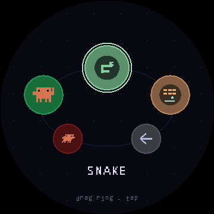
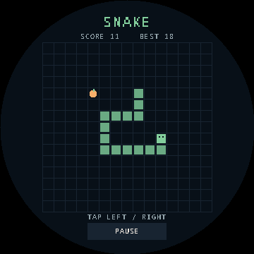
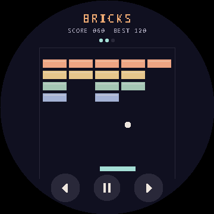
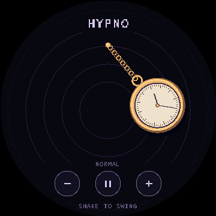
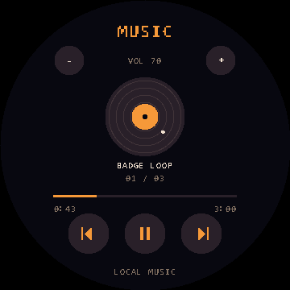
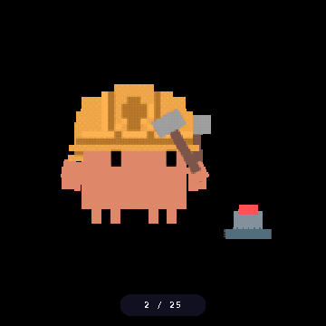
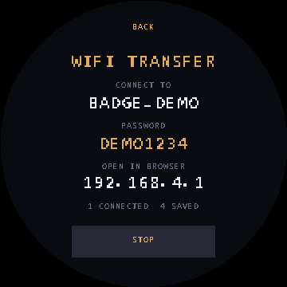
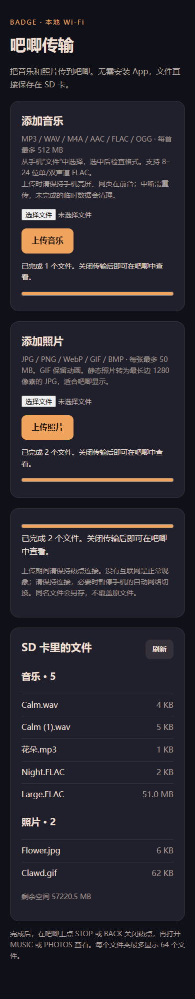

# esp32-badge · CLAWD PET

[简体中文](README.md) | **English**

An ESP32 pet badge with a round screen: **pet care, accessories and XiaoZhi voice chat in one CLAWD PET app**.
Built for the Waveshare **ESP32-S3-Touch-LCD-1.85B**, with a 1.85-inch 360×360 touchscreen, six-axis sensor, microphones and speaker connections.

- **One shared pet**: an egg, seven growth forms, feeding, petting, dragging, rest and cleaning. Conversations retain its form and accessories, with expressions and Chinese subtitles.
- **20 pixel accessories**: flowers, hard hats, headphones, wizard hats and more, drawn over the original body without changing its proportions. Preview, cancel or save in the wardrobe.
- **Drag the home carousel**: move along the ring, release to snap, and tap to open. No clock in the upper-left corner.
- **GAMES folder**: four mini-games in a separate carousel with the same controls as home. Leaving a game returns to the folder.
- **Full-screen photos**: swipe or tap the sides to browse, with the image index below. A **650ms** hold keeps the original full-screen / complete-image toggle.
- **24 built-in Clawd animations**: typing, thinking, sleeping, sweeping, headphones, miniature forms and more. Original animations remain available offline, followed by SD-card photos.
- **HYPNO inertial watch**: shake the badge left/right to drive the pendulum, which gradually settles when motion stops. Tap to pause/resume; the bottom minus/plus controls select three sensitivities.
- **SNAKE / BRICKS**: tap relative to the snake's head to turn; touch either half of the screen to move the paddle. Both support pause, scores, per-boot high scores and retries.
- **MUSIC local player**: SD audio including MP3 and WAV, with track switching, pause/resume, seeking and volume. An empty music folder can generate an original demo loop.
- **Wi-Fi transfer**: start a local hotspot in settings and upload music or photos in batches from a phone or computer, without removing the card.
- **USB status and low-power sleep**: USB reconnect and zero-current recovery have been checked on the board. CHARGE ONLY turns off the display and sleeps; BOOT wakes it. Charging status appears in settings only.
- **Separate touch and drawing schedules**: a **20ms** input target, approximately **30ms** measured on this device. Power saving reduces drawing frequency; contact wakes and highlights controls, release executes once, and feedback remains for about **150ms**.

Device checks cover home-carousel dragging, pet interaction, online voice conversation and photo display; scan intervals vary with load.
On 2026-10-17, the user confirmed game launch and BACK navigation in GAMES, the snake's bottom pause area, and taps/holds on either screen half in BRICKS.

| Home | CLAWD PET care |
|---|---|
|  |  |
| Wardrobe | XiaoZhi voice |
|  |  |

| GAMES folder | SNAKE | BRICKS |
|---|---|---|
|  |  |  |

*Images are generated by the shared C++ renderer, not photographs of the LCD. The voice preview does not include the LVGL Chinese subtitle overlay.*





Quick links: **[Build and update](#build-and-update)** · **[Voice integration and controls](docs/clawd-pet-voice.md)** · **[Hardware](docs/hardware.md)** · **[Verification](#verification)** · **[Firmware slots](#firmware-slots)**

This repo holds the launcher, games, shared pet model, ESP-IDF voice integration,
tools and hardware notes. Upstream SDKs, local flash backups and build output are
not vendored; see [Setup](#setup).

## Hardware

| | |
|---|---|
| MCU | ESP32-S3R8, dual-core LX7 @ 240MHz |
| Memory | 512KB SRAM + **8MB OPI PSRAM** |
| Flash | **16MB** NOR |
| Display | 1.85" round IPS, 360×360, **ST77916**, QSPI, RGB565 |
| Touch | **CST816S**, I²C `0x15` |
| IMU | **QMI8658** 6-axis, I²C `0x6B`, ±2–16g / ±32–4096dps |
| Audio | ES8311 codec `0x30` + ES7210 echo-cancel `0x80`, dual mics, speaker pads |
| Other | PCF85063 RTC `0x51`, BQ27220 fuel gauge `0x55`, microSD (4-bit SDMMC) |
| Radio | WiFi 2.4GHz b/g/n + BLE 5 |
| Power | USB-C or MX1.25 3.7V LiPo (onboard charging) |

Pin map, free-GPIO analysis and expansion notes: **[docs/hardware.md](docs/hardware.md)**

The USB-C port is wired straight to the chip's native USB-Serial/JTAG
(`VID:PID = 303A:1001`) — there is no USB-to-UART bridge chip on the board.

## Repo layout

```
esp32-badge/
├── system/                    the firmware that runs on the badge (launcher + games)
├── firmware/clawd_pet/         ESP-IDF voice display, input adapter and UI pacing
├── assets/clawd-gifs/          24 original animations for PHOTOS and wardrobe references
├── games/clawd-roll/          the same game as a standalone sketch, no launcher
├── lib/
│   ├── board_drivers/         shared Arduino library: ST77916 panel, CST816 touch, I2C
│   └── badge_audio_i2s/        isolated local audio decoder, 256fs MCLK and I2S cleanup fixes
├── docs/
│   └── hardware.md            pin map, free GPIOs, expansion notes
├── tools/
│   ├── build.sh               compile / flash helper (arduino-cli)
│   ├── deploy_game.sh         build a sketch, write only the factory app, boot it
│   ├── prepare_clawd_voice.py prepare the pinned XiaoZhi source + shared pet overlay
│   ├── install_voice_pet.py   verify / back up / install the integrated ota_0 pet
│   ├── switch_slot.py         choose which slot the bootloader starts
│   ├── restore_stock.sh       restore the factory firmware
│   ├── serial_monitor.py      native CDC monitor (DTR enabled, RTS inactive)
│   ├── convert_sprite.py      flat-colour art -> 2bpp indexed C header
│   ├── make_font.py           bake an 8x8 ASCII bitmap font
│   ├── make_icon.py           render the project icon
│   ├── idf_install_steps.bat  install ESP-IDF toolchain (Git Bash friendly)
│   └── idf_env.bat            activate ESP-IDF env and run a command
├── README.md                 Chinese documentation
└── README.en.md              English documentation
```

`arduino-cli`, the upstream Waveshare repo, ESP-IDF, build output and flash backups
are all gitignored — follow the setup below to recreate them locally.

## Setup

### 1. Upstream sources (not in git)

```bash
git clone --depth 1 https://github.com/waveshareteam/ESP32-S3-Touch-LCD-1.85B.git
```

Contains the official Arduino + ESP-IDF examples, the published factory firmware,
and the schematic. The ESP-IDF examples include `05_esp-brookesia` (an ESP-Brookesia
framework demo) and `06_qmi8658_test` (IMU check).

> **`05_esp-brookesia` is not the full shipping system.** It builds the same
> ESP-Brookesia *Phone* framework with the same dark stylesheet, but it only installs
> the `SquarelineDemo` app (`main/main.cpp`). The apps the shipped binary actually has
> — XiaoZhi, Video Player, Chipmunk2d, and the rest — are **not** in this source tree,
> so rebuilding it gives you a reduced system, not a byte-equivalent one. The
> prebuilt binary in `Firmware/` is the only faithful copy of the stock system, which
> is why backing it up matters.

### 2. Arduino path

```bash
# arduino-cli: https://github.com/arduino/arduino-cli/releases  -> drop into tools/
arduino-cli config init
arduino-cli core update-index
arduino-cli core install esp32:esp32@3.2.0

# Waveshare's bundled libraries (lvgl 8.4, SensorLib, ES8311/ES7210, ...)
cp -r ESP32-S3-Touch-LCD-1.85B/Examples/Arduino-V3.2.0/libraries/* \
      "$(arduino-cli config get directories.user)/libraries/"
```

If you are behind a proxy: `arduino-cli config set network.proxy http://127.0.0.1:7897`

### 3. ESP-IDF path (for the integrated voice pet)

```bash
git clone -b v5.5.3 --depth 1 --shallow-submodules --recursive \
    https://github.com/espressif/esp-idf.git
cmd.exe //c "tools\idf_install_steps.bat"        # installs the esp32s3 toolchain
cmd.exe //c "tools\idf_env.bat idf.py --version" # sanity check
```

## Build and update

Make a [full flash backup](#back-up-before-you-flash) before the first installation.
The supported layout keeps our Arduino launcher in `factory` and the integrated
ESP-IDF voice pet in `ota_0`; both use the existing partition table.

Build or update the launcher from Git Bash:

```bash
PARTITION_SCHEME=custom ./tools/build.sh compile system  # build only
./tools/deploy_game.sh system COM3                     # build, write factory app, boot
```

Use the app-only deploy helper for this layout. The generic `build.sh upload/both`
path is an Arduino upload and can also write the bootloader and partition table;
it is not the update path for this two-firmware installation.

Build the voice pet from PowerShell at the repository root:

```powershell
python tools/prepare_clawd_voice.py
$voiceBuild = Join-Path (Get-Location) "build/clawd-voice"
cmd /c tools\idf_env.bat idf.py -C reference/xiaozhi -B "$voiceBuild" set-target esp32s3 # first build
cmd /c tools\idf_env.bat idf.py -C reference/xiaozhi -B "$voiceBuild" build
python tools/install_voice_pet.py          # verify artifacts; dry run
python tools/install_voice_pet.py --flash  # back up current slot/config, write ota_0 only
```

This uses XiaoZhi **v2.3.0** with ESP-IDF **5.5.3** and pinned dependencies.
The installer requires the local full backup to verify the partition table, and
checks the connected device before writing. Open CLAWD PET from the launcher after
installation. Do not use plain `idf.py flash`: the generated flash arguments target
`factory` and include bootloader/table writes. Detailed build notes are in
[docs/clawd-pet-voice.md](docs/clawd-pet-voice.md).

Board options are baked into `build.sh`. The non-default ones matter:

| Option | Value | Why |
|---|---|---|
| `CDCOnBoot` | `cdc` | USB-C goes to the chip's native USB-Serial/JTAG; without this `Serial` never appears over USB |
| `FlashSize` | `16M` | onboard flash |
| `PSRAM` | `opi` | onboard octal PSRAM |
| `FlashMode` | `qio` | QIO 80MHz |
| `PartitionScheme` | `custom` | `system/partitions.csv`, matching the installed factory / ota_0 / assets layout |

`build.sh` defaults to a generic Arduino partition scheme, so the explicit
`PARTITION_SCHEME=custom` above matters; `deploy_game.sh` sets it automatically.

## Verification

```bash
python tools/native_checks.py      # execute real shared C++ logic on the host; requires g++
python tools/preview_pet.py        # render the shared pet code; also needs Pillow
python tools/preview_launcher.py   # Python preview of the launcher layout
python tools/preview_readme.py     # regenerate README images from actual C++ drawing; needs Pillow
python tools/preview_power.py      # render the POWER page with a charging fixture
python tools/preview_hypno.py --animation # actual C++ frame and optional swing GIF
python tools/preview_music.py      # actual music screen with a deterministic track fixture
python tools/preview_minigames.py  # real snake/bricks logic tests, screenshots and updated launcher
python tools/make_clawd_album.py --check # embedded GIFs match the original assets
```

Checks cover photo scaling and crop boundaries, ring dragging and snapping,
save migration, care, wardrobe persistence, accessory clipping in both RGB565 byte
orders, button press/release feedback, BQ27220 charging state, HYPNO sensor motion/sensitivity/pause
and UI pacing across timer wrap. Host renders
complement device checks; they do not measure LCD transfer or touch-controller latency.

The launcher's LCD path copies PSRAM pixels into a reusable 8-row internal DMA
buffer and waits for each strip before reusing it. This avoids the failed large
transfers that left stale red bands on screen. Serial `D` includes a completed
transfer counter; transfer errors and timeouts are reported instead of ignored.

## The system

The firmware that occupies `factory` is the project's own little system: it boots into
a launcher ring of games, and each game is an independent module behind the `Game`
interface. Adding an app means appending its class instance to `GAMES`; add mini-games to `MINI_GAMES` in
`system/system.ino`.

```
system/
├── system.ino            setup/loop, screen dispatch, the game registry
├── gfx.{h,cpp}           framebuffer primitives, rotated 2bpp sprites, 8x8 text
├── input.{h,cpp}         tilt (with auto-trim), touch, BOOT button
├── arena.{h,cpp}         the shared backdrop: wall ring, floor dots
├── launcher.{h,cpp}      shared home/folder carousel and navigation tiles
├── game.h                the Game interface
├── game_clawd.{h,cpp}    tilt-controlled rolling clawd
├── game_tap.{h,cpp}      touch-controlled clawd tap
├── game_snake.{h,cpp}    15×15 head-relative tap controls, turn queue and pause
├── game_bricks.{h,cpp}   left/right screen touch zones, 20 bricks, three lives and pause
├── game_pet.{h,cpp}      CLAWD PET: care, egg, evolution, gestures and voice presentation
├── outfits.{h,cpp}       twenty accessories over the existing pet body
├── game_photos.{h,cpp}   SD-card photos and animations, fill / fit toggle
├── clawd_album.{h,cpp}   24 built-in original Clawd GIFs, read directly from flash
├── game_hypno.{h,cpp}    sensor-driven pocket watch, pause and motion sensitivity
├── game_music.{h,cpp}    SD audio player, controls and audio-driver ownership
├── game_settings.{h,cpp} volume, and what is under the hood
├── power.{h,cpp}         the BQ27220 fuel gauge
├── clawd_sprite.h        the sprite + palette, shared by both games
├── assets_clawd.h        generated 2bpp sprite
├── assets_icons.h        generated per-app launcher icons
├── assets_mon.h          generated seven-form pet bodies
├── assets_font.h         generated 8x8 ASCII font
└── partitions.csv        must match the installed layout — see Firmware slots below
```

The six home entries are CLAWD PET, PHOTOS, MUSIC, HYPNO, GAMES and SETTINGS.
GAMES opens a second carousel with CLAWD ROLL, CLAWD TAP, SNAKE, BRICKS and BACK.
Both rings use the same touch-drag, tap and tilt controls and remember their selection.
Each module draws its own icon; the pet has one entry for both care and voice.
CLAWD PET keeps its classic orange launcher icon; inside the app, the creature's
body color continues to follow its current evolution form.

Battery voltage, percentage, signed current and BatteryStatus come from the BQ27220
gauge. SETTINGS → POWER separately shows USB CONNECTED when the ESP32 receives
USB host packets, and the battery's measured CHARGING, DISCHARGING, FULL or
CHARGE UNKNOWN state. The delayed DSG flag cannot override a new current reading.
A cable connection or 100% reading alone is not treated as proof
of charging or completed charging; failed status reads show STATUS UNKNOWN.
USB connection detection works with the computer's serial monitor closed. A power
bank/charger sends no host packets, so an absent USB label does not prove the cable
is unplugged. Battery-current detection remains independent of USB data traffic.
Zero current is displayed as CHARGE UNKNOWN: it cannot confirm the charger chip's
state. It is not displayed as "not charging".
Serial `B` reports USB status, connection/disconnection counts and read-only gauge
registers; `S` opens SETTINGS for display checks.

**Battery capacity must match the installed battery.** The BQ27220's default 3000mAh value does not mean a 3000mAh battery is fitted.
The user confirmed **500mAh / 1.85Wh, with a 4.2V charging limit** on this device. Serial `C500` explicitly configures that battery:
after backing up the old parameters, it changes only the gauge's RAM full-charge and design capacities, reads them back and reinitializes the estimate.
Once verified, capacity is saved in local NVS and restored when the launcher detects that the gauge has returned to its defaults.
Unconfigured devices are not automatically assigned 500mAh, and valid learned full-charge capacity is not overwritten.
This does not program OTP or change the charger, current calibration, battery chemistry curve, or voltage/temperature protection.
Correcting capacity does not complete battery calibration immediately; percentages remain estimates to check against a full charge and normal use.
Both capacities were read back as 500mAh and retained after an MCU restart. At that check, the new estimate was approximately 80%, with about +150mA net current.

**Automatic zero-current recovery after USB reconnect was verified on the device on 2026-10-17.** Previously, reconnecting the computer's USB cable left the gauge reporting
`0mA` and BatteryStatus `0x5029/0x5028`. A comparison without rebooting showed that a short load reduction restored positive current, which remained positive after normal load resumed.
The firmware now attempts one load-reduction recovery of at most four seconds only when a computer is connected, readings are valid, current is zero and the SLEEP flag persists for two seconds.
The screen may go dark for about 2–4 seconds before returning automatically; BOOT is not needed. Each actual connection allows at most one attempt.
The user confirmed automatic recovery and CHARGING after reconnecting. Subsequent serial samples were approximately **+155mA**.
See the full [charging diagnostic record](docs/charging-diagnostics.md).

The complete electrical cause remains unresolved; compatibility with arbitrary chargers and full-charge behavior have not been fully verified. Failed recovery still shows **CHARGE UNKNOWN**.
Positive current means the gauge measures net current entering the battery. It does not replace the charger's STAT signal, and a USB connection alone is never classified as charging.

**SETTINGS** has VOLUME, SYSTEM, NET, USB, POWER and WIFI pages behind a small arc menu. VOLUME is the assistant's level,
kept in the NVS key its own AudioCodec::Start() reads — see system/audio.h for why that
key and not the codec's register, which the assistant rewrites on every boot. SYSTEM is
the chip, memory, build and battery; NET shows stored assistant configuration. USB
provides the SD-card access mode. WIFI starts a local hotspot for media transfer;
the integrated voice pet retains its own assistant networking configuration.

**Wireless music and photo transfer: SETTINGS → WIFI → START HOTSPOT.**

1. Connect your phone or computer to the displayed `BADGE-xxxx` hotspot using the password on the badge.
2. Stay connected even if the system reports no internet, then open `http://192.168.4.1` in a browser.
3. Select music or photos, individually or in batches. The page shows progress and the SD-card file list.
4. When finished, use STOP / BACK on the badge, or hold BOOT to return home, then reopen MUSIC / PHOTOS to rescan.

Music uploads accept MP3, WAV, M4A/AAC, FLAC and OGG. The music picker displays all files and checks the format after selection,
so phones that misclassify FLAC do not disable it; select the file from the phone's Files app.
The webpage converts still JPG/PNG/WebP images to JPEG with a maximum dimension of 1280 pixels for the album decoder.
GIF and BMP are uploaded unchanged, preserving GIF animation.
Limits are **512 MiB per music file**, 50 MiB per photo and 64 media files per folder.
Uploads write directly to the SD card through buffers no larger than 4 KiB. Music is stored unchanged, without automatic recompression or transcoding.
Small network packets are combined into 4 KiB writes instead of making a fragmented card write for every TCP packet.
Serial save logs report elapsed time, receive waits, card-write time and actual average KiB/s; webpage upload speed alone does not establish the Wi-Fi hardware limit.
Beside the upload button, the page shows selected size, preparation status, bytes sent, progress, errors and a cancel control.
Active transfers have no five-minute total limit. A 45-second period with no progress ends the wait, and the device removes unfinished files.
Keep the phone awake and the webpage in the foreground. Screen lock or app switching can suspend the browser.
Resumable upload is not supported: after interruption, select and upload again. Incomplete temporary files never enter the playlist;
temporary files left by unexpected power loss are removed the next time the hotspot starts.
Duplicate names receive numeric suffixes, so existing files are not overwritten. Interrupted uploads delete their temporary data;
only completely written files enter the player or album.
A separate HTTP task writes upload chunks while the UI remains usable. Exit waits for the upload task to finish, unmounts the SD card and stops the hotspot,
without changing XiaoZhi's Wi-Fi configuration. The hotspot has its own device password stored in the `badge-transfer` namespace.

After a native FLAC upload, the device reads STREAMINFO and reports sample rate, bit depth and channel count without decoding or modifying the file.
The current decoder supports 8–24-bit mono/stereo FLAC with blocks no larger than 8192 samples.
Prediction and channel reconstruction retain the source bit depth before converting to 16-bit PCM for audio output; the SD-card FLAC remains unchanged.
Fixes address high-bit-depth LPC overflow, mono output spacing and STREAMINFO parameters not reaching the decoder.
The input buffer is 256 KiB, with enough frame space for 24-bit stereo. Decoder failure shows a playback error instead of remaining at 0:00 while claiming to play.
FLAC time advances from decoded sample counts, avoiding jumps caused by variable bitrate and partial output.
Higher sample rates still need per-file performance measurements. Neither the extension nor upload success proves playability;
playback performance is checked through actual I2S output frames increasing over time.




Transfer checks: `python tools/native_checks.py` exercises the real upload handler's duplicate-name protection, chunked writes,
interruption cleanup, filename rules and size limits. `node tools/test_transfer_web.cjs` checks batch uploads, photo conversion and GIF preservation.
Coverage includes chunked checks above 64 MiB against the real handler and a browser regression that creates and uploads an actual 51 MiB file,
plus errors beside the button, cancellation, no-progress timeout and FLAC bit-depth hints.
Browser checks use local Edge and Playwright; `BADGE_NODE_MODULES` can select the dependency directory.
`python tools/test_flac_decoder.py` uses FFmpeg to generate real 16/24-bit, mono/stereo FLAC with different encodings,
compiles the production decoder and compares every PCM sample with FFmpeg output, including 8192-sample blocks and high-bit-depth prediction.
A 54,393,782-byte, 24-bit / 48kHz stereo FLAC was verified on the badge: duration 4:09, largest frame 20,473 bytes,
approximately 48,000 actual I2S frames per second and zero write errors. The user confirmed continuous, normal audio.
Serial `W` opens and starts Wi-Fi transfer; `D` reports clients, received bytes and saved-file count.

**Charge-only mode: SETTINGS → POWER → CHARGE ONLY.** The page shows battery level and charging state, then turns off the backlight and display output and puts the MCU and radios into deep sleep.
Press **BOOT** to wake. The onboard charger still controls battery charging independently; charging current and battery parameters are not increased or changed.
USB serial disconnects during sleep, so wake with BOOT before flashing.

USB powers the board automatically. With the cable attached, a PWR shutdown request cannot cut VBUS power; this is the board's power-path behavior,
as described in the [vendor FAQ](https://docs.waveshare.com/ESP32-S3-Touch-LCD-1.85B/FAQ).
Charge-only mode reduces running consumption; actual charging speed still depends on the charger IC, battery stage and USB supply.


The left example detects a computer and positive gauge current. The right detects a computer but zero current, leaving charging unconfirmed.
Neither case incorrectly shows ON BATTERY.

**Controls.** Drag a finger around the application ring to rotate it; release to snap
to the nearest app. Tap an icon or the centre to open it. Tilt remains optional and
is suppressed during touch. The home screen has no clock. Hold BOOT in a game to
return to the GAMES folder; hold it there or tap BACK to return home. Other apps
return directly home. In the voice pet a long press returns to the launcher firmware.

**PHOTOS.** Includes **24 distinct original Clawd GIFs**, followed by the SD card's
`/Photos` contents. Swipe left for next and right for previous, or tap the right/left
side. The bottom shows the current index and total. Holding for 650ms keeps its
original function: toggle centre-cropped full-screen view and complete-image fit;
release after a hold never advances the picture. The default fills the round panel.
Built-in full-screen view centers the visible artwork with a consistent body scale;
complete-image view retains the original canvas. Transparent pixels use the dark
background, with previous-frame disposal and per-frame palettes composited correctly.
GIF coordinates are cached, deadlines use wall-clock time, and unchanged pictures
produce no redundant LCD transfers.
The built-in GIFs play with no SD card and are read
directly from flash, without loading the whole album into RAM or changing existing
SD files. Baseline JPEG, BMP and animated GIF are supported for SD pictures.
`tools/make_clawd_album.py` embeds the deduplicated source bytes unchanged (1,947,672
bytes of flash), and `--check` verifies that the generated header still matches.
Serial `P` opens PHOTOS, `N` advances and `J` goes back for device checks.
Serial `D` reports actual animation FPS and decode/compose/scale timing; `F` captures
the current framebuffer. `python tools/verify_album_frames.py` compares all 1,262
source animation frames against independent Pillow decoding, pixel for pixel.
That check requires g++, Pillow, NumPy and a local AnimatedGIF source installation;
use `--gif-library /path/to/AnimatedGIF/src` to override its location. All 24 gallery
entries have also been captured from the physical board and matched to source frames;
the corrected background, animation and size were confirmed on the device.
On the physical board, three sampled animations ran at 14.88–14.98fps (the source
frames alternate 60/70ms). The previous compositor/cadence ran at 9.53–10.07fps.
This leaves the original animations intact rather than replacing them with stills.

**MUSIC.** Reads MP3, WAV, AAC/M4A, FLAC and Ogg files in the card's `/Music`
folder. The three bottom controls are previous, pause/resume and next; the progress
bar seeks and the upper `−` / `+` controls adjust volume. Tracks wrap around at EOF.
When the folder has no supported music, an original eight-second PCM WAV demo is
created as `/Music/Badge-Loop.wav`; existing user tracks are not replaced.
Hold BOOT for about 900ms to return home. Entering/exiting releases and restores
the I2S driver without a reboot; the local decoder fork uses the ES8311's 256fs
MCLK and disables its IDF 5 channel before deleting it. Serial `M` opens the player,
`V` pauses/resumes and `N` / `J` change tracks. Decoding and I2S output run in a
separate core-0 task so LCD transfers and touch polling cannot starve playback.
Player/SD operations are serialized; exit waits for the worker before deleting the
decoder, unmounting the card and restoring launcher audio.

The PCM observer explicitly forwards samples to I2S. Serial `D` distinguishes
callback attempts from complete stereo frames accepted by I2S, and reports write
errors, worker timing and remaining stack. `U40` temporarily sets the shared codec
volume to 40% without saving it. On the physical board, a 44.1kHz/128kbps stereo MP3
delivered approximately 44,100 stereo frames per second with the music animation
running, versus approximately 28,000 when decoding ran once per UI loop.

**HYPNO.** Shake the badge left/right to drive the gold pocket watch. It uses the
QMI8658 acceleration sample already read by the input loop, with an inertial pendulum
and damping, with a relaxed free-swing period of about 3.4 seconds. A slowly tracked
gravity baseline permits different holding positions;
there is no automatic periodic swing while the badge is still. The rings move with
the pendulum's motion and stop as it settles.
Tap the scene or middle pause/play button to freeze/resume; `−` / `+` select SOFT,
NORMAL or STRONG motion sensitivity. Motion during pause is sampled without building
up an impulse for resume. Dragging cancels a tap. Redraws are capped at 30fps;
paused/resting frames do not repeatedly transfer the display. Hold BOOT about 900ms
to return home. Each entry starts stationary at NORMAL sensitivity; saved pet and
battery data are untouched. Serial `Y` opens HYPNO; `D` reports real raw acceleration,
motion drive, angle and velocity. The software preview feeds simulated acceleration
through the same motion/rendering code and is not a recording of a physical shake.

```bash
./tools/deploy_game.sh system          # update the launcher app in factory; keep ota_0
./tools/deploy_game.sh games/clawd-roll   # or deploy the standalone game sketch
python tools/make_font.py              # regenerate the bitmap font
python tools/make_mon_sprites.py       # regenerate the shared pet's seven forms
python tools/make_icon_sprites.py      # regenerate the three launcher icons
python tools/make_icon.py              # regenerate the project icon

python tools/preview_pet.py            # check the pet's layout before flashing it
python tools/preview_icons.py          # the launcher icons, on the carousel's discs
python tools/preview_launcher.py       # likewise for the carousel
python tools/check_preview_sync.py     # run the real C++ regression checks
```

The Arduino launcher renders directly into one 360×360 RGB565 framebuffer in PSRAM
and pushes changed bands to the panel (`Game::dirtyY0/dirtyY1`). The ESP-IDF voice pet
uses the same C++ drawing code through an LVGL 9 display adapter, with a drawing
buffer and a stable image buffer in PSRAM; changed rows are copied and invalidated.
Touch sampling runs independently of drawing, including while the display is idle.

**Tilt input.** This board uses a fixed measured axis mapping: Z is perpendicular
to the screen, screen X is inverted sensor X, and screen Y is sensor Y. A boot-time
average is logged for diagnostics; it does not select the mapping. There is no
boot-angle zeroing calibration: with gravity-sensed tilt,
level *is* zero, and subtracting a boot-time snapshot only bakes in whatever angle
the board happened to be held at — worse, the constant residual that leaves behind
pins a ball against a wall. Instead a slow auto-trim removes the accelerometer's
static offset, but only while the board is near level, so it never fights a player
who is deliberately leaning in.

## Games

### clawd-roll


Tilt the board and clawd rolls; let up and it coasts; hit the arena wall and it
bounces, with a ring that expands at the point of contact. No score, no goal — it is a
thing that feels good to wobble.

Also buildable as a standalone single-game firmware, which is useful when you want to
iterate on the physics without the launcher in the way:

```bash
./tools/deploy_game.sh games/clawd-roll
python tools/convert_sprite.py games/clawd-roll/clawd-source.png \
       games/clawd-roll/clawd_asset.h --name clawd --body E83B3B
```

### clawd-tap

Touch counterpart: clawd pops up somewhere in the arena, waits a shrinking moment,
and vanishes. Tap it to score, three time-outs and it is over. It exists as much to
exercise the game interface as to be played — between it and clawd-roll both input
paths and both ends of the drawing cost are covered.

### SNAKE / BRICKS

Open **GAMES** from home for the same carousel layout, containing **CLAWD ROLL, CLAWD TAP, SNAKE and BRICKS**.
Tap **BACK** or hold BOOT for about 0.9 seconds to return home. Inside a game, hold BOOT for about 0.9 seconds to return to the folder with its selection preserved.
One hold returns only one level. Holding BOOT for about 2.2 seconds on home still enters the voice system.


Both new games work fully offline. Tap **PLAY** to start, use the bottom pause control to pause/resume,
and tap **RETRY** after a round. High scores last until the next reboot.

| SNAKE | BRICKS |
|---|---|
|  |  |

**SNAKE:** the entire 15×15 grid fits inside the round display. While moving horizontally, tap above or below the snake's head to turn up or down;
while moving vertically, tap left or right of its head to turn left or right. Direction is relative to the head, not the screen center.
Eat orange food to score and gradually speed up. Hitting a wall or the body ends the round; filling the grid wins.
Direct reversal is prevented, and rapid turns are queued for successive movement steps.
Each tap registers once, with the eyes immediately previewing the next turn. Touching anywhere in the bottom strip pauses or resumes on contact;
you do not need to hit the text, finger drift before release does not cancel it, and brief contact bounce cannot toggle repeatedly.
Unchanged screens are not repeatedly transferred.

**BRICKS:** touch the left half of the screen to move left and the right half to move right.
A tap moves one step immediately; holding beyond about 180ms moves continuously.
There are no small arrows to aim for. Drift within a half does not cancel movement; crossing the middle switches direction, with the corresponding arena edge highlighted.
The large bottom-center area pauses/resumes on contact. After losing a ball, position the paddle with either half, then tap bottom **PLAY** to serve.
The rebound angle depends on where the ball hits the paddle. There are 20 bricks, three lives and ten points per brick; clearing every brick wins.
Physics uses substeps no longer than 8ms to prevent fast balls passing through bricks. Rendering usually runs at about 30fps.
Repeated main-loop iterations within one millisecond advance zero time, so skipped display refreshes do not speed up gameplay.

`python tools/preview_minigames.py` compiles and runs the real game logic, covering queued turns, food, tail/body collisions,
a full-grid win, rebounds, lost lives, a complete brick-clearing round, head-relative taps, half-screen taps/holds,
whole-footer pause and debounce, drawing cadence and framebuffer bounds. It generates the game screenshots, six-entry home and folder images above.
Serial `GAMES` opens the folder, `GSNAKE` / `GBRICKS` open the games, and `D` reports state.
`folder_nav` checks the actual registries, touch launch, parent returns, restored selection and BOOT hold latch.
`launcher_drag` checks dragging, tapping and angle wrap for both the six-entry home and five-entry folder.
`frame_timing` covers short loops, long stalls and millisecond-counter wrap, preventing elapsed-time errors from accumulating in idle loops.

### CLAWD PET

The former clawd-pet and pixel-mon are one app. It combines the touch/drag/poke and
shake-to-scrub interaction with eggs, two evolution tracks and seven forms. The
same care and drawing source runs in the Arduino launcher and the ESP-IDF voice
companion. When no current save exists, migration prefers the old PIXEL MON save,
then the original pet save. Old saves are retained; new progress uses `clawdpet2/blob`.

Tap **SCRUB**, then gently shake the badge back and forth to clear five dirt spots. Completion adds 55 cleanliness points.
Motion detection uses changes on all three axes and supports horizontal or vertical shaking. Tap to finish, or wait for the 20-second timeout;
partial cleaning progress is retained.
The voice pet uses the 6DOF / 8g configuration from the [official Waveshare QMI8658 driver](https://github.com/waveshareteam/ESP32-S3-Touch-LCD-1.85B/blob/main/Examples/ESP-IDF-V5.5.3/06_qmi8658_test/components/waveshare__qmi8658/qmi8658.c),
while the host still samples every 50ms. This avoids the persistent zero readings seen with the previous accelerometer-only configuration.

The optional integrated voice version uses XiaoZhi's open client with this board's
existing hardware support. The on-screen creature listens, responds with expressions
and subtitles, and exposes its current needs through a read-only MCP tool.
Press BOOT once or tap the top of the pet page to start/stop a conversation; hold
BOOT to return home. Care buttons work while chat is idle, and the idle header no
longer shows a standby label.
See [CLAWD PET voice build and controls](docs/clawd-pet-voice.md).

**The egg.** The first screen is an egg, drawn rather than a sprite. It hatches while it
is *warm*, which means energy and cleanliness both above 40, so the needs are
load-bearing before there is anything to look after: about three minutes of a warm egg,
plus four points a poke. Tapping it makes it wobble; something taps back. Until it
hatches the live menu items are PET and STYLE; rename remains inside STYLE.

**The tree.** Two tracks accumulate in the background, from the *state* of the needs
rather than from one button pressed at the right moment:

| track | fed by |
|---|---|
| joy | happiness, plus playing, petting, being poked |
| vigor | energy and cleanliness, plus sleeping and finishing a scrub |

Evolution then needs both an age and care points — one point per minute spent with the
four needs averaging above 70 — and the gates are short on purpose: a badge is picked up
for ten minutes at a time, so a tree that needs an hour of good care is a tree that never
gets climbed.

| | gate | outcome |
|---|---|---|
| EGG → BABY | hatch reaches 100% | **PIP** |
| BABY → CHILD | 5 min, care 6 | whichever track leads: **LEAF** (joy) or **AQUA** (vigor) |
| CHILD → ADULT | 20 min, care 25 | **BLOOM** / **TIDE** along the bloodline, **SOLAR** if the two tracks end level, **DUSK** if the average care of that stage fell below 45 |

The announcement names the branch and the reason — `PIP is now BLOOM (joy)` — and the
serial line prints joy, vigor and the care average, so a surprising result can be checked
rather than argued with.

**Sleep is the only thing that restores energy**, at nine points a minute, and the mon
wakes itself when it is full. Resting contributes to the vigor branch; while asleep,
FEED, PLAY, PET and SCRUB are disabled, while REST and STYLE remain available.

**The dex.** The bottom line reads `GROW 3/6  SEEN 2/7` — the first half names whichever
condition is actually holding evolution up, and switches to `AGE 4m` once care is done and
only the clock is left. `SEEN` is a bitmask that survives a new egg, which is the point of
the wardrobe's secondary action: once the mon is an adult, RENAME becomes NEW EGG.
Starting over is how the other five forms get found.

The forms are clawd's silhouette at one size per stage with the form's colour and a
one-pixel outline. ORIGINAL adds the form's head mark — a leaf, a drop, a flower,
a crest, a halo, two dim puffs. `tools/make_mon_sprites.py` regenerates the bitmaps; the
marks are code, because at this size a mark is three shapes and a bitmap is another
1.5 KB per form.

**Wardrobe.** STYLE opens twenty pixel accessories, plus ORIGINAL: a flower,
hard hat, headphones, thought bubble, bubbles, sleeping cap, glasses, book,
delivery bag, bow, crown, beret, halo, star, wizard hat, heart, cap, earmuffs,
rainbow and antenna. Swipe the
preview or use the arrows, choose WEAR to save or BACK to cancel. Every accessory
uses the same existing body dimensions, eyes and voice expression; it never scales
or replaces the creature. The GIF references are kept in `assets/clawd-gifs/`, while
`system/outfits.cpp` draws the lightweight accessories directly. Selection uses the
independent `clawdpet2/outfit` key, preserving the original care-save layout.

## Firmware slots

The current installation has two app images. The Arduino launcher keeps games,
photos and settings in `factory`; the integrated CLAWD PET runs care and XiaoZhi
voice together in `ota_0`. Installing it **replaces the original XiaoZhi 2.2.4 app**
in that slot, after backing it up, while retaining the shared fonts and speech models.

```
factory  app   0x020000  6.57MiB   Arduino launcher, games, photos, settings
ota_0    app   0x6c0000  4.00MiB   CLAWD PET + XiaoZhi v2.3.0 voice client
assets   data  0xac0000  4.00MiB   existing fonts + speech models, preserved
```

Switching app images changes the 8KiB `otadata` boot selector and restarts;
care interactions and conversations then stay inside the same pet app.

| | |
|---|---|
| launcher → open **CLAWD PET** | detects the installed voice pet, selects `ota_0`, restarts into it |
| voice pet → **hold BOOT** | saves care progress, selects `factory`, restarts into our launcher |

Both directions live in the firmwares themselves; neither needs a host computer, a
reflash or a power cycle. Erased `otadata` falls back to `factory`; a selected voice
pet continues to boot until the launcher is selected again. Without the voice image,
the launcher entry runs the local care-only pet.

```bash
python tools/switch_slot.py home     # select factory / our launcher
python tools/switch_slot.py stock    # legacy command name: selects ota_0 / installed voice pet
python tools/switch_slot.py status   # read the boot selector, then reboot the application
```

For updates, use `deploy_game.sh system` for the launcher and
`install_voice_pet.py --flash` for the voice pet. These app updates preserve the
bootloader, partition table and shared assets.

`install_stack.py` is a **legacy restoration tool**: it installs the launcher and
restores the original assistant from `backup/`, overwriting the custom voice pet.
It is not a voice-pet updater. `restore_stock.sh` restores the whole 16MiB image,
including the original main app, assistant, bootloader, table and saved configuration.

### Why the games are not entries in the stock system's launcher

That would be the natural place for them, and it is not possible with what Waveshare
ships:

- The stock system is a **prebuilt binary**. Nothing in the published repository is
  its source: `05_esp-brookesia` builds the same ESP-Brookesia *framework* with the
  same stylesheet, but installs only the `SquarelineDemo` app, and the
  `brookesia_core` component contains framework code only — no settings, weather,
  music, video or game apps at all.
- The `assets` partition is a packed resource table, not an app filesystem. Reading
  it back off the device shows fonts, `srmodels.bin` (speech models) and an
  `index.json` — there is no runtime app loading and no app store in this build.

Upstream ESP-Brookesia does have a runtime-app mechanism (`runtime/brookesia_runtime_js`,
`_lua`, `_wasm`, `_elf`, plus `app/brookesia_app_store`), so a system built from
source *could* list the game in a launcher. That is the path to take if a launcher is
wanted, but the closed stock apps would still need replacements. This project uses
its own launcher and integrates the open XiaoZhi client into CLAWD PET instead.

`system/partitions.csv` and the standalone game's table encode the existing layout.
The voice installer checks its generated table against both the full backup and
the connected board. The app-only launcher deploy assumes this layout is already
installed; an incompatible table would send runtime lookups to the wrong regions.

The `otadata` entry format has three traps worth knowing if you touch the code:
the checksum covers **only the 4-byte `ota_seq`**, not the whole struct; ESP-IDF's
`esp_rom_crc32_le` inverts both its input and its output (it is *not* zlib's crc32);
and `ota_state` must be `VALID`, because anything the bootloader finds in
`PENDING_VERIFY` or `NEW` is treated as unconfirmed and rolled back.

## Back up before you flash

Before modifying a stock device, save its whole flash so it can be restored
byte-for-byte. Keep that original backup rather than overwriting it with a later
custom installation. Backups include device configuration and are gitignored.

```bash
mkdir -p backup
esptool --chip esp32s3 --port COM3 --baud 921600 --after watchdog_reset \
    read_flash 0 0x1000000 backup/1.85B-stock-16MB.bin
```

Then restore any time with:

```bash
./tools/restore_stock.sh          # uses backup/ if present, else Waveshare's published image
```

## Gotchas worth knowing

**The touch controller stops answering I2C when it is idle.** `Touch_Init()` leaves
the CST816S in auto-sleep, and a sleeping controller does not respond on the bus — so
code that polls it every frame produces a continuous stream of
`i2c.master: I2C transaction unexpected nack detected` until the screen is touched.
The vendor function that is supposed to control this cannot:

```c
void CST816_AutoSleep(bool Sleep_State) {
  ...
  uint8_t Sleep_State_Set = (uint8_t)(!Sleep_State);
  Sleep_State_Set = 10;                              // overwrites the computed value
  I2C_Write_Touch(CST816_ADDR, CST816_REG_DisAutoSleep, &Sleep_State_Set, 1);
}
```

The register needs `0x01` to disable auto-sleep; it always receives `10`. The
library's `Touch_SetAutoSleep(false)` writes the correct value without the controller
reset that the vendor function also performs, and `input::init()` calls it.

**The native USB port can strand the chip in download mode.** The USB-C connector
goes straight to USB-Serial/JTAG. On this badge native HWCDC requires DTR asserted
for incoming commands; DTR alone does not reset it. Toggling RTS with DTR asserted
can reset into the ROM download loader. Keep RTS inactive for monitoring and never
use a reset-based esptool probe just to check whether the application is running.

Recovery, in order of convenience:

1. **Watchdog reset via esptool** — usually enough to break the sticky state and boot
   the application, with no physical access needed:

   ```bash
   esptool --chip esp32s3 --port COM3 --baud 921600 \
       --after watchdog_reset --connect-attempts 1 read_mac
   ```

   A watchdog reset takes a different path than the RTS/EN reset. Verify that the
   app is running with `serial_monitor.py` and its startup logs. A failed ROM probe
   alone cannot distinguish a running app from a disconnected or unavailable port.

2. **Cold power cycle** — always works: unplug USB (and if a battery is attached,
   long-press PWR 2s to power off, then short-press to power on). A cold boot samples
   the strapping pins correctly with GPIO0 pulled high.

Use `tools/serial_monitor.py` instead of ad-hoc pyserial code — it enables DTR for native CDC
and never pulses RTS, so it attaches and detaches without disturbing a running app:

```bash
python tools/serial_monitor.py COM3 115200
python tools/serial_monitor.py COM3 --seconds 20     # bounded capture
```

**Never let esptool rewrite the image header when restoring a dump.** When writing
a raw flash dump at `0x0`, esptool patches the flash-parameter byte (offset 2, SPI
mode) if you pass `--flash_mode` / `--flash_size` / `--flash_freq`. The stock
bootloader's header is marked **DIO** — it upgrades itself to QIO at runtime — so
forcing `--flash_mode qio` there leaves the bootloader unable to read flash and the
board watchdog-resets in a loop (`rst:0x7 TG0WDT_SYS_RST`), with nothing on the
console but the ROM banner.

Always restore with `keep`:

```bash
esptool --chip esp32s3 --port COM3 --baud 921600 --after watchdog_reset write_flash \
    --flash_mode keep --flash_size keep --flash_freq keep --verify \
    0x0 backup/1.85B-stock-16MB.bin
```

esptool's "Hash of data verified" is not a safety net here — it checks the data
*after* patching, so it passes either way. `tools/restore_stock.sh` already does
this correctly.

**Two different LVGL versions.** The Arduino examples ship **LVGL 8.4.0**; the
ESP-IDF examples and the stock system use **LVGL 9.5.0**. The APIs are not
compatible (`lv_scr_act()` vs `lv_screen_active()`, the display/indev API was
reworked). Check which version any example you copy was written for.

**Generic example uploads can replace the installed layout.** The stock system is
a compiled app, not an OS that installs arbitrary Arduino sketches. An ordinary
demo upload may also rewrite the bootloader and partition table. This project's
app-only update tools use the existing slots; a full stock restore deliberately
replaces both custom apps and their saved configuration.

**Driving ESP-IDF scripts from Git Bash.** Two traps:

1. `cmd.exe /c script.bat` does not work from Git Bash — MSYS rewrites `/c` into a
   path. Use the doubled form: `cmd.exe //c script.bat`.
2. `idf_tools.py` and `install.bat` abort with *"MSys/Mingw is not supported"*
   whenever `MSYSTEM` is in the environment, which Git Bash sets for every child
   process. `tools/idf_install_steps.bat` and `tools/idf_env.bat` clear it first.

**Only 3 free GPIOs** (7, 8, 18) — everything else is taken by onboard peripherals
or the flash/PSRAM bus. Need more IO? Use an I²C expander on the exposed I²C
header. Details in [docs/hardware.md](docs/hardware.md).

**3.3V logic.** Classic 5V Arduino boards need level shifting before connecting.

## Current status and next work

- [x] Six-entry home carousel and GAMES folder carousel, touch-drag, snapping, tilt and parent navigation
- [x] HYPNO sensor-driven inertial pocket watch, three sensitivities, damping and pause/resume
- [x] CLAWD ROLL and CLAWD TAP mini-games
- [x] SNAKE and BRICKS mini-games, touch controls, pause, retry and per-boot high scores
- [x] Unified CLAWD PET care, eggs, seven evolution forms and migrated saves
- [x] Integrated XiaoZhi voice, expressions, Chinese subtitles and shared pet state
- [x] Twenty accessories with unchanged body proportions and persistent selection
- [x] SD-card photos / GIFs with full-screen crop and complete-image fit
- [x] Twenty-four built-in Clawd GIFs, available offline alongside SD-card photos
- [x] Photo left/right navigation and page index, with original hold-to-fill/fit retained
- [x] Local SD music player with pause, track switching, seeking and volume controls
- [x] Independent touch scanning, wake on contact and visible button feedback
- [ ] Longer battery-life and simultaneous voice/care soak tests
- [ ] Broader media-file and SD-card compatibility checks

## License

**AGPL-3.0** — see [LICENSE](LICENSE), and [NOTICE.md](NOTICE.md) for the third-party
material this repository carries and its terms.

The short version of why that licence: the clawd artwork comes from an AGPL-3.0
project, so shipping the source under anything more permissive would not have been
consistent. If the artwork is replaced with something original the obligation goes
with it. The board drivers are Apache-2.0 (compatible), and the pet's design follows
an MIT project without copying its code.

## Links

- [Waveshare docs](https://docs.waveshare.net/ESP32-S3-Touch-LCD-1.85B)
- [Waveshare repo](https://github.com/waveshareteam/ESP32-S3-Touch-LCD-1.85B)
- [esp-brookesia](https://github.com/espressif/esp-brookesia) — the HMI framework the stock system is built on
- [LVGL](https://lvgl.io)

**Anything that talks to the serial port must finish by booting the app.** On this
board a chip left in the ROM download loader looks completely dead — black screen, no
response to the power button — while still enumerating over USB, and a power cycle is
not an escape because USB keeps it powered. Worse, it is invisible from the host side:
every subsequent `esptool` call resets on connect and sees a perfectly healthy boot,
so the tooling keeps reporting success while the screen stays dark. Always end with
`--after watchdog_reset`, never leave a `--after no_reset` step as the final one.
