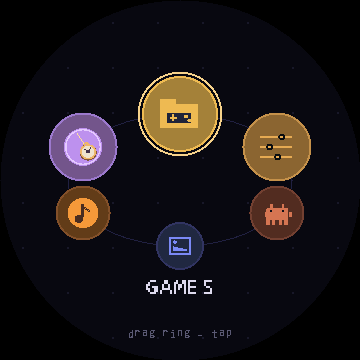
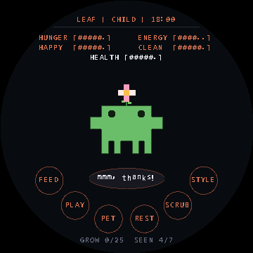
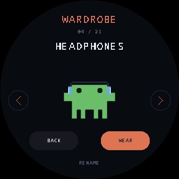
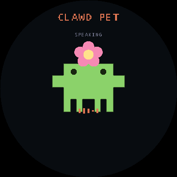
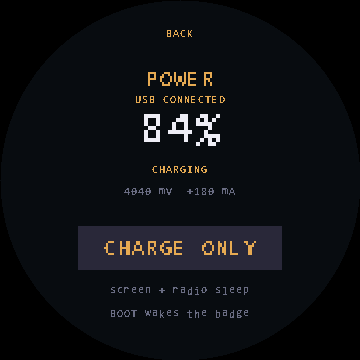
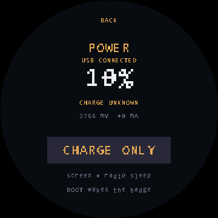
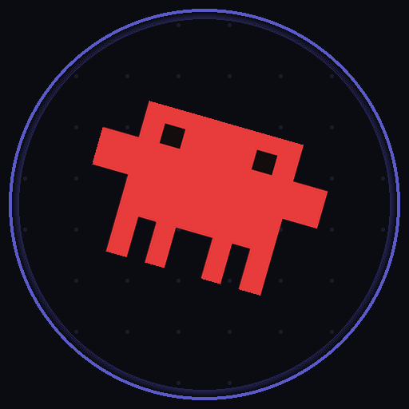

# esp32-badge · CLAWD PET

一只运行在圆屏 ESP32 上的电子吧唧桌宠：**养成、换装和小智语音聊天，放进同一个 CLAWD PET**。
硬件是 Waveshare **ESP32-S3-Touch-LCD-1.85B**，1.85 英寸 360×360 触摸屏，带六轴传感器、麦克风和扬声器接口。

- **同一只宠物**：蛋、七种成长形态、喂食、抚摸、拖动、休息和清洁；对话时保留形态与配饰，显示表情和中文字幕。
- **20 种像素配饰**：花朵、安全帽、耳机、巫师帽等叠加在原身体上，体型和比例保持一致；衣柜支持预览、取消和保存。
- **手指拖转主页**：沿应用圆环滑动，松手吸附，点击打开；主页没有左上角时钟。
- **满屏相册**：默认等比居中裁剪铺满，长按约 **650ms** 切换完整显示，再长按恢复铺满。
- **USB 连接提示与省电休眠**：电脑插拔及零电流读数的自动恢复已通过实机验证；CHARGE ONLY 熄屏休眠，按 BOOT 唤醒。充电状态仅显示在设置里。
- **触摸与绘制分开调度**：输入目标 **20ms**，本机实测约 **30ms**；省电只降低绘制频率，按下即唤醒并高亮，松手执行一次，反馈保留约 **150ms**。

实机验证：主页拖转、桌宠互动、语音联网对话和相册显示已通过，触摸操作顺畅；扫描间隔会随运行负载变化。

| 主页 | CLAWD PET 养成 |
|---|---|
|  |  |
| 衣柜 | 小智语音 |
|  |  |

*图示由共享 C++ 绘制代码生成，非 LCD 实拍；语音图不包含 LVGL 中文字幕覆盖层。*

Quick links: **[Build and update](#build-and-update)** · **[Voice integration and controls](docs/clawd-pet-voice.md)** · **[Hardware](docs/hardware.md)** · **[Verification](#verification)** · **[Firmware slots](#firmware-slots)**

This repo holds the launcher, games, shared pet model, ESP-IDF voice integration,
tools and hardware notes. Upstream SDKs, local flash backups and build output are
not vendored; see [Setup](#setup).

## Hardware

| | |
|---|---|
| MCU | ESP32-S3R8, dual-core LX7 @ 240MHz |
| Memory | 512KB SRAM + **8MB OPI PSRAM** |
| Flash | **16MB** NOR |
| Display | 1.85" round IPS, 360×360, **ST77916**, QSPI, RGB565 |
| Touch | **CST816S**, I²C `0x15` |
| IMU | **QMI8658** 6-axis, I²C `0x6B`, ±2–16g / ±32–4096dps |
| Audio | ES8311 codec `0x30` + ES7210 echo-cancel `0x80`, dual mics, speaker pads |
| Other | PCF85063 RTC `0x51`, BQ27220 fuel gauge `0x55`, microSD (4-bit SDMMC) |
| Radio | WiFi 2.4GHz b/g/n + BLE 5 |
| Power | USB-C or MX1.25 3.7V LiPo (onboard charging) |

Pin map, free-GPIO analysis and expansion notes: **[docs/hardware.md](docs/hardware.md)**

The USB-C port is wired straight to the chip's native USB-Serial/JTAG
(`VID:PID = 303A:1001`) — there is no USB-to-UART bridge chip on the board.

## Repo layout

```
esp32-badge/
├── system/                    the firmware that runs on the badge (launcher + games)
├── firmware/clawd_pet/         ESP-IDF voice display, input adapter and UI pacing
├── assets/clawd-gifs/          deduplicated artwork references; not full GIF pets in firmware
├── games/clawd-roll/          the same game as a standalone sketch, no launcher
├── lib/
│   └── board_drivers/         shared Arduino library: ST77916 panel, CST816 touch, I2C
├── docs/
│   └── hardware.md            pin map, free GPIOs, expansion notes
├── tools/
│   ├── build.sh               compile / flash helper (arduino-cli)
│   ├── deploy_game.sh         build a sketch, write only the factory app, boot it
│   ├── prepare_clawd_voice.py prepare the pinned XiaoZhi source + shared pet overlay
│   ├── install_voice_pet.py   verify / back up / install the integrated ota_0 pet
│   ├── switch_slot.py         choose which slot the bootloader starts
│   ├── restore_stock.sh       restore the factory firmware
│   ├── serial_monitor.py      native CDC monitor (DTR enabled, RTS inactive)
│   ├── convert_sprite.py      flat-colour art -> 2bpp indexed C header
│   ├── make_font.py           bake an 8x8 ASCII bitmap font
│   ├── make_icon.py           render the project icon
│   ├── idf_install_steps.bat  install ESP-IDF toolchain (Git Bash friendly)
│   └── idf_env.bat            activate ESP-IDF env and run a command
└── README.md
```

`arduino-cli`, the upstream Waveshare repo, ESP-IDF, build output and flash backups
are all gitignored — follow the setup below to recreate them locally.

## Setup

### 1. Upstream sources (not in git)

```bash
git clone --depth 1 https://github.com/waveshareteam/ESP32-S3-Touch-LCD-1.85B.git
```

Contains the official Arduino + ESP-IDF examples, the published factory firmware,
and the schematic. The ESP-IDF examples include `05_esp-brookesia` (an ESP-Brookesia
framework demo) and `06_qmi8658_test` (IMU check).

> **`05_esp-brookesia` is not the full shipping system.** It builds the same
> ESP-Brookesia *Phone* framework with the same dark stylesheet, but it only installs
> the `SquarelineDemo` app (`main/main.cpp`). The apps the shipped binary actually has
> — XiaoZhi, Video Player, Chipmunk2d, and the rest — are **not** in this source tree,
> so rebuilding it gives you a reduced system, not a byte-equivalent one. The
> prebuilt binary in `Firmware/` is the only faithful copy of the stock system, which
> is why backing it up matters.

### 2. Arduino path

```bash
# arduino-cli: https://github.com/arduino/arduino-cli/releases  -> drop into tools/
arduino-cli config init
arduino-cli core update-index
arduino-cli core install esp32:esp32@3.2.0

# Waveshare's bundled libraries (lvgl 8.4, SensorLib, ES8311/ES7210, ...)
cp -r ESP32-S3-Touch-LCD-1.85B/Examples/Arduino-V3.2.0/libraries/* \
      "$(arduino-cli config get directories.user)/libraries/"
```

If you are behind a proxy: `arduino-cli config set network.proxy http://127.0.0.1:7897`

### 3. ESP-IDF path (for the integrated voice pet)

```bash
git clone -b v5.5.3 --depth 1 --shallow-submodules --recursive \
    https://github.com/espressif/esp-idf.git
cmd.exe //c "tools\idf_install_steps.bat"        # installs the esp32s3 toolchain
cmd.exe //c "tools\idf_env.bat idf.py --version" # sanity check
```

## Build and update

Make a [full flash backup](#back-up-before-you-flash) before the first installation.
The supported layout keeps our Arduino launcher in `factory` and the integrated
ESP-IDF voice pet in `ota_0`; both use the existing partition table.

Build or update the launcher from Git Bash:

```bash
PARTITION_SCHEME=custom ./tools/build.sh compile system  # build only
./tools/deploy_game.sh system COM3                     # build, write factory app, boot
```

Use the app-only deploy helper for this layout. The generic `build.sh upload/both`
path is an Arduino upload and can also write the bootloader and partition table;
it is not the update path for this two-firmware installation.

Build the voice pet from PowerShell at the repository root:

```powershell
python tools/prepare_clawd_voice.py
$voiceBuild = Join-Path (Get-Location) "build/clawd-voice"
cmd /c tools\idf_env.bat idf.py -C reference/xiaozhi -B "$voiceBuild" set-target esp32s3 # first build
cmd /c tools\idf_env.bat idf.py -C reference/xiaozhi -B "$voiceBuild" build
python tools/install_voice_pet.py          # verify artifacts; dry run
python tools/install_voice_pet.py --flash  # back up current slot/config, write ota_0 only
```

This uses XiaoZhi **v2.3.0** with ESP-IDF **5.5.3** and pinned dependencies.
The installer requires the local full backup to verify the partition table, and
checks the connected device before writing. Open CLAWD PET from the launcher after
installation. Do not use plain `idf.py flash`: the generated flash arguments target
`factory` and include bootloader/table writes. Detailed build notes are in
[docs/clawd-pet-voice.md](docs/clawd-pet-voice.md).

Board options are baked into `build.sh`. The non-default ones matter:

| Option | Value | Why |
|---|---|---|
| `CDCOnBoot` | `cdc` | USB-C goes to the chip's native USB-Serial/JTAG; without this `Serial` never appears over USB |
| `FlashSize` | `16M` | onboard flash |
| `PSRAM` | `opi` | onboard octal PSRAM |
| `FlashMode` | `qio` | QIO 80MHz |
| `PartitionScheme` | `custom` | `system/partitions.csv`, matching the installed factory / ota_0 / assets layout |

`build.sh` defaults to a generic Arduino partition scheme, so the explicit
`PARTITION_SCHEME=custom` above matters; `deploy_game.sh` sets it automatically.

## Verification

```bash
python tools/native_checks.py      # execute real shared C++ logic on the host; requires g++
python tools/preview_pet.py        # render the shared pet code; also needs Pillow
python tools/preview_launcher.py   # Python preview of the launcher layout
python tools/preview_readme.py     # regenerate README images from actual C++ drawing; needs Pillow
python tools/preview_power.py      # render the POWER page with a charging fixture
```

Checks cover photo scaling and crop boundaries, ring dragging and snapping,
save migration, care, wardrobe persistence, accessory clipping in both RGB565 byte
orders, button press/release feedback, BQ27220 charging state and UI pacing across timer wrap. Host renders
complement device checks; they do not measure LCD transfer or touch-controller latency.

The launcher's LCD path copies PSRAM pixels into a reusable 8-row internal DMA
buffer and waits for each strip before reusing it. This avoids the failed large
transfers that left stale red bands on screen. Serial `D` includes a completed
transfer counter; transfer errors and timeouts are reported instead of ignored.

## The system

The firmware that occupies `factory` is the project's own little system: it boots into
a launcher ring of games, and each game is an independent module behind the `Game`
interface. Adding one means writing a class and appending a pointer to `GAMES` in
`system/system.ino`.

```
system/
├── system.ino            setup/loop, screen dispatch, the game registry
├── gfx.{h,cpp}           framebuffer primitives, rotated 2bpp sprites, 8x8 text
├── input.{h,cpp}         tilt (with auto-trim), touch, BOOT button
├── arena.{h,cpp}         the shared backdrop: wall ring, floor dots
├── launcher.{h,cpp}      the carousel home screen
├── game.h                the Game interface
├── game_clawd.{h,cpp}    tilt-controlled rolling clawd
├── game_tap.{h,cpp}      touch-controlled clawd tap
├── game_pet.{h,cpp}      CLAWD PET: care, egg, evolution, gestures and voice presentation
├── outfits.{h,cpp}       twenty accessories over the existing pet body
├── game_photos.{h,cpp}   SD-card photos and animations, fill / fit toggle
├── game_settings.{h,cpp} volume, and what is under the hood
├── power.{h,cpp}         the BQ27220 fuel gauge
├── clawd_sprite.h        the sprite + palette, shared by both games
├── assets_clawd.h        generated 2bpp sprite
├── assets_icons.h        generated per-app launcher icons
├── assets_mon.h          generated seven-form pet bodies
├── assets_font.h         generated 8x8 ASCII font
└── partitions.csv        must match the installed layout — see Firmware slots below
```

The five launcher entries are CLAWD ROLL, CLAWD TAP, CLAWD PET, PHOTOS and SETTINGS.
Each module draws its own icon; the pet has one entry for both care and voice.
CLAWD PET keeps its classic orange launcher icon; inside the app, the creature's
body color continues to follow its current evolution form.

Battery voltage, percentage, signed current and BatteryStatus come from the BQ27220
gauge. SETTINGS → POWER separately shows USB CONNECTED when the ESP32 receives
USB host packets, and the battery's measured CHARGING, DISCHARGING, FULL or
CHARGE UNKNOWN state. The delayed DSG flag cannot override a new current reading.
A cable connection or 100% reading alone is not treated as proof
of charging or completed charging; failed status reads show STATUS UNKNOWN.
USB connection detection works with the computer's serial monitor closed. A power
bank/charger sends no host packets, so an absent USB label does not prove the cable
is unplugged. Battery-current detection remains independent of USB data traffic.
Zero current is displayed as CHARGE UNKNOWN: it cannot confirm the charger chip's
state. It is not displayed as "not charging".
Serial `B` reports USB status, connection/disconnection counts and read-only gauge
registers; `S` opens SETTINGS for display checks.

**电池容量必须匹配实物。** BQ27220 的默认容量为 3000mAh，不能据此认定实际装有 3000mAh 电池。
本机用户确认电池为 **500mAh / 1.85Wh，充电限制电压 4.2V**。串口 `C500` 显式配置该电池：
备份原参数后，只修改电量计 RAM 中的满电容量和设计容量，读回校验并重新初始化估算；
配置成功后将容量保存到本机 NVS，在启动器开机发现电量计回到默认容量时恢复。
未配置的设备不自动套用 500mAh，也不覆盖正常学习得到的满电容量。
此操作不烧写 OTP，不修改充电芯片、电流校准、电池化学曲线或电压/温度保护。
修正容量不等于立即完成电池校准；新的百分比仍是估算值，需要后续实际充满和正常使用核对。
本机已读回确认两项容量均为 500mAh，主控重启后仍保留；重新估算约 80%，正向电流约 +150mA。

**重插后零读数的自动恢复已通过实机验证（2026-10-17）。** 此前重插电脑 USB 后，电量计会持续报告
`0mA`、BatteryStatus `0x5029/0x5028`。不重启的对照证明，短暂降负载后读数可恢复为正电流，恢复正常负载后仍保持充电。
固件现在仅在电脑连接、读数有效、零电流且 SLEEP 标志持续 2 秒时，尝试一次最多 4 秒的降负载恢复。
屏幕可能短暂熄灭约 2～4 秒，随后回到原页面，无需按 BOOT；每次实际连接最多尝试一次，避免反复熄屏。
用户已确认重插后自动恢复并显示 CHARGING，后续串口连续采样约为 **+155mA**。
完整测试数据见 [充电诊断记录](docs/charging-diagnostics.md)。

异常的完整电气原因仍未确定，任意充电器兼容性与充满状态尚未完整验证。恢复失败仍显示 **CHARGE UNKNOWN**。
正电流表示电量计测到电池有净流入电流，不代替充电芯片 STAT 状态，也不会用 USB 连接直接判定充电。

**SETTINGS** has VOLUME, SYSTEM, NET, USB and POWER pages behind a small arc menu. VOLUME is the assistant's level,
kept in the NVS key its own AudioCodec::Start() reads — see system/audio.h for why that
key and not the codec's register, which the assistant rewrites on every boot. SYSTEM is
the chip, memory, build and battery; NET shows stored assistant configuration. USB
provides the SD-card access mode. The integrated voice pet handles assistant networking.

**仅充电：SETTINGS → POWER → CHARGE ONLY。** 页面显示当前电量与充电状态，随后关闭背光与显示输出，让主控和无线硬件进入深度休眠；按 **BOOT** 唤醒。电池充电仍由板载充电芯片独立控制，没有提高充电电流或修改电池参数。休眠时 USB 串口会断开，烧录前先按 BOOT 唤醒。

USB 插入后会自动给主板供电；插线时 PWR 的关机请求无法切断 VBUS 供电。这是板卡电源路径行为，见 [板厂 FAQ](https://docs.waveshare.com/ESP32-S3-Touch-LCD-1.85B/FAQ)。仅充电模式用于减少运行耗电，实际充电速度仍受充电芯片、电池阶段和 USB 供电限制。




左图为检测到电脑且电量计报告正向电流；右图为检测到电脑、零电流且充电状态未确认。两种状态均不会再显示 ON BATTERY。

**Controls.** Drag a finger around the application ring to rotate it; release to snap
to the nearest app. Tap an icon or the centre to open it. Tilt remains optional and
is suppressed during touch. The home screen has no clock. Hold BOOT in a game to
return home; in the voice pet a long press returns to the launcher firmware.

**PHOTOS.** Tap to advance; hold for 650ms to toggle centre-cropped full-screen view
and complete-image fit. The default fills the round panel, without a filename bar.
Baseline JPEG, BMP and animated GIF are supported. Unsupported images show an error.

```bash
./tools/deploy_game.sh system          # update the launcher app in factory; keep ota_0
./tools/deploy_game.sh games/clawd-roll   # or deploy the standalone game sketch
python tools/make_font.py              # regenerate the bitmap font
python tools/make_mon_sprites.py       # regenerate the shared pet's seven forms
python tools/make_icon_sprites.py      # regenerate the three launcher icons
python tools/make_icon.py              # regenerate the project icon

python tools/preview_pet.py            # check the pet's layout before flashing it
python tools/preview_icons.py          # the launcher icons, on the carousel's discs
python tools/preview_launcher.py       # likewise for the carousel
python tools/check_preview_sync.py     # run the real C++ regression checks
```

The Arduino launcher renders directly into one 360×360 RGB565 framebuffer in PSRAM
and pushes changed bands to the panel (`Game::dirtyY0/dirtyY1`). The ESP-IDF voice pet
uses the same C++ drawing code through an LVGL 9 display adapter, with a drawing
buffer and a stable image buffer in PSRAM; changed rows are copied and invalidated.
Touch sampling runs independently of drawing, including while the display is idle.

**Tilt input.** This board uses a fixed measured axis mapping: Z is perpendicular
to the screen, screen X is inverted sensor X, and screen Y is sensor Y. A boot-time
average is logged for diagnostics; it does not select the mapping. There is no
boot-angle zeroing calibration: with gravity-sensed tilt,
level *is* zero, and subtracting a boot-time snapshot only bakes in whatever angle
the board happened to be held at — worse, the constant residual that leaves behind
pins a ball against a wall. Instead a slow auto-trim removes the accelerometer's
static offset, but only while the board is near level, so it never fights a player
who is deliberately leaning in.

## Games

### clawd-roll



Tilt the board and clawd rolls; let up and it coasts; hit the arena wall and it
bounces, with a ring that expands at the point of contact. No score, no goal — it is a
thing that feels good to wobble.

Also buildable as a standalone single-game firmware, which is useful when you want to
iterate on the physics without the launcher in the way:

```bash
./tools/deploy_game.sh games/clawd-roll
python tools/convert_sprite.py games/clawd-roll/clawd-source.png \
       games/clawd-roll/clawd_asset.h --name clawd --body E83B3B
```

### clawd-tap

Touch counterpart: clawd pops up somewhere in the arena, waits a shrinking moment,
and vanishes. Tap it to score, three time-outs and it is over. It exists as much to
exercise the game interface as to be played — between it and clawd-roll both input
paths and both ends of the drawing cost are covered.

### CLAWD PET

The former clawd-pet and pixel-mon are one app. It combines the touch/drag/poke and
shake-to-scrub interaction with eggs, two evolution tracks and seven forms. The
same care and drawing source runs in the Arduino launcher and the ESP-IDF voice
companion. When no current save exists, migration prefers the old PIXEL MON save,
then the original pet save. Old saves are retained; new progress uses `clawdpet2/blob`.

点击 **SCRUB** 后轻轻来回摇动设备，清除 5 处污点；完成增加 55 点清洁度。
摇晃识别使用三轴变化，支持横向、纵向摇动；点击屏幕可结束，20 秒后自动退出并保留已完成部分的清洁度。
语音桌宠沿用 [Waveshare 官方 QMI8658 驱动](https://github.com/waveshareteam/ESP32-S3-Touch-LCD-1.85B/blob/main/Examples/ESP-IDF-V5.5.3/06_qmi8658_test/components/waveshare__qmi8658/qmi8658.c) 的 6DOF / 8g 配置，主机仍每 50ms 采样一次，避免原先仅加速度配置下持续读到零的情况。

The optional integrated voice version uses XiaoZhi's open client with this board's
existing hardware support. The on-screen creature listens, responds with expressions
and subtitles, and exposes its current needs through a read-only MCP tool.
Press BOOT once or tap the top of the pet page to start/stop a conversation; hold
BOOT to return home. Care buttons work while chat is idle, and the idle header no
longer shows “待命”.
See [CLAWD PET voice build and controls](docs/clawd-pet-voice.md).

**The egg.** The first screen is an egg, drawn rather than a sprite. It hatches while it
is *warm*, which means energy and cleanliness both above 40, so the needs are
load-bearing before there is anything to look after: about three minutes of a warm egg,
plus four points a poke. Tapping it makes it wobble; something taps back. Until it
hatches the live menu items are PET and STYLE; rename remains inside STYLE.

**The tree.** Two tracks accumulate in the background, from the *state* of the needs
rather than from one button pressed at the right moment:

| track | fed by |
|---|---|
| joy | happiness, plus playing, petting, being poked |
| vigor | energy and cleanliness, plus sleeping and finishing a scrub |

Evolution then needs both an age and care points — one point per minute spent with the
four needs averaging above 70 — and the gates are short on purpose: a badge is picked up
for ten minutes at a time, so a tree that needs an hour of good care is a tree that never
gets climbed.

| | gate | outcome |
|---|---|---|
| EGG → BABY | hatch reaches 100% | **PIP** |
| BABY → CHILD | 5 min, care 6 | whichever track leads: **LEAF** (joy) or **AQUA** (vigor) |
| CHILD → ADULT | 20 min, care 25 | **BLOOM** / **TIDE** along the bloodline, **SOLAR** if the two tracks end level, **DUSK** if the average care of that stage fell below 45 |

The announcement names the branch and the reason — `PIP is now BLOOM (joy)` — and the
serial line prints joy, vigor and the care average, so a surprising result can be checked
rather than argued with.

**Sleep is the only thing that restores energy**, at nine points a minute, and the mon
wakes itself when it is full. Resting contributes to the vigor branch; while asleep,
FEED, PLAY, PET and SCRUB are disabled, while REST and STYLE remain available.

**The dex.** The bottom line reads `GROW 3/6  SEEN 2/7` — the first half names whichever
condition is actually holding evolution up, and switches to `AGE 4m` once care is done and
only the clock is left. `SEEN` is a bitmask that survives a new egg, which is the point of
the wardrobe's secondary action: once the mon is an adult, RENAME becomes NEW EGG.
Starting over is how the other five forms get found.

The forms are clawd's silhouette at one size per stage with the form's colour and a
one-pixel outline. ORIGINAL adds the form's head mark — a leaf, a drop, a flower,
a crest, a halo, two dim puffs. `tools/make_mon_sprites.py` regenerates the bitmaps; the
marks are code, because at this size a mark is three shapes and a bitmap is another
1.5 KB per form.

**Wardrobe.** STYLE opens twenty pixel accessories, plus ORIGINAL: a flower,
hard hat, headphones, thought bubble, bubbles, sleeping cap, glasses, book,
delivery bag, bow, crown, beret, halo, star, wizard hat, heart, cap, earmuffs,
rainbow and antenna. Swipe the
preview or use the arrows, choose WEAR to save or BACK to cancel. Every accessory
uses the same existing body dimensions, eyes and voice expression; it never scales
or replaces the creature. The GIF references are kept in `assets/clawd-gifs/`, while
`system/outfits.cpp` draws the lightweight accessories directly. Selection uses the
independent `clawdpet2/outfit` key, preserving the original care-save layout.

## Firmware slots

The current installation has two app images. The Arduino launcher keeps games,
photos and settings in `factory`; the integrated CLAWD PET runs care and XiaoZhi
voice together in `ota_0`. Installing it **replaces the original XiaoZhi 2.2.4 app**
in that slot, after backing it up, while retaining the shared fonts and speech models.

```
factory  app   0x020000  6.57MiB   Arduino launcher, games, photos, settings
ota_0    app   0x6c0000  4.00MiB   CLAWD PET + XiaoZhi v2.3.0 voice client
assets   data  0xac0000  4.00MiB   existing fonts + speech models, preserved
```

Switching app images changes the 8KiB `otadata` boot selector and restarts;
care interactions and conversations then stay inside the same pet app.

| | |
|---|---|
| launcher → open **CLAWD PET** | detects the installed voice pet, selects `ota_0`, restarts into it |
| voice pet → **hold BOOT** | saves care progress, selects `factory`, restarts into our launcher |

Both directions live in the firmwares themselves; neither needs a host computer, a
reflash or a power cycle. Erased `otadata` falls back to `factory`; a selected voice
pet continues to boot until the launcher is selected again. Without the voice image,
the launcher entry runs the local care-only pet.

```bash
python tools/switch_slot.py home     # select factory / our launcher
python tools/switch_slot.py stock    # legacy command name: selects ota_0 / installed voice pet
python tools/switch_slot.py status   # read the boot selector, then reboot the application
```

For updates, use `deploy_game.sh system` for the launcher and
`install_voice_pet.py --flash` for the voice pet. These app updates preserve the
bootloader, partition table and shared assets.

`install_stack.py` is a **legacy restoration tool**: it installs the launcher and
restores the original assistant from `backup/`, overwriting the custom voice pet.
It is not a voice-pet updater. `restore_stock.sh` restores the whole 16MiB image,
including the original main app, assistant, bootloader, table and saved configuration.

### Why the games are not entries in the stock system's launcher

That would be the natural place for them, and it is not possible with what Waveshare
ships:

- The stock system is a **prebuilt binary**. Nothing in the published repository is
  its source: `05_esp-brookesia` builds the same ESP-Brookesia *framework* with the
  same stylesheet, but installs only the `SquarelineDemo` app, and the
  `brookesia_core` component contains framework code only — no settings, weather,
  music, video or game apps at all.
- The `assets` partition is a packed resource table, not an app filesystem. Reading
  it back off the device shows fonts, `srmodels.bin` (speech models) and an
  `index.json` — there is no runtime app loading and no app store in this build.

Upstream ESP-Brookesia does have a runtime-app mechanism (`runtime/brookesia_runtime_js`,
`_lua`, `_wasm`, `_elf`, plus `app/brookesia_app_store`), so a system built from
source *could* list the game in a launcher. That is the path to take if a launcher is
wanted, but the closed stock apps would still need replacements. This project uses
its own launcher and integrates the open XiaoZhi client into CLAWD PET instead.

`system/partitions.csv` and the standalone game's table encode the existing layout.
The voice installer checks its generated table against both the full backup and
the connected board. The app-only launcher deploy assumes this layout is already
installed; an incompatible table would send runtime lookups to the wrong regions.

The `otadata` entry format has three traps worth knowing if you touch the code:
the checksum covers **only the 4-byte `ota_seq`**, not the whole struct; ESP-IDF's
`esp_rom_crc32_le` inverts both its input and its output (it is *not* zlib's crc32);
and `ota_state` must be `VALID`, because anything the bootloader finds in
`PENDING_VERIFY` or `NEW` is treated as unconfirmed and rolled back.

## Back up before you flash

Before modifying a stock device, save its whole flash so it can be restored
byte-for-byte. Keep that original backup rather than overwriting it with a later
custom installation. Backups include device configuration and are gitignored.

```bash
mkdir -p backup
esptool --chip esp32s3 --port COM3 --baud 921600 --after watchdog_reset \
    read_flash 0 0x1000000 backup/1.85B-stock-16MB.bin
```

Then restore any time with:

```bash
./tools/restore_stock.sh          # uses backup/ if present, else Waveshare's published image
```

## Gotchas worth knowing

**The touch controller stops answering I2C when it is idle.** `Touch_Init()` leaves
the CST816S in auto-sleep, and a sleeping controller does not respond on the bus — so
code that polls it every frame produces a continuous stream of
`i2c.master: I2C transaction unexpected nack detected` until the screen is touched.
The vendor function that is supposed to control this cannot:

```c
void CST816_AutoSleep(bool Sleep_State) {
  ...
  uint8_t Sleep_State_Set = (uint8_t)(!Sleep_State);
  Sleep_State_Set = 10;                              // overwrites the computed value
  I2C_Write_Touch(CST816_ADDR, CST816_REG_DisAutoSleep, &Sleep_State_Set, 1);
}
```

The register needs `0x01` to disable auto-sleep; it always receives `10`. The
library's `Touch_SetAutoSleep(false)` writes the correct value without the controller
reset that the vendor function also performs, and `input::init()` calls it.

**The native USB port can strand the chip in download mode.** The USB-C connector
goes straight to USB-Serial/JTAG. On this badge native HWCDC requires DTR asserted
for incoming commands; DTR alone does not reset it. Toggling RTS with DTR asserted
can reset into the ROM download loader. Keep RTS inactive for monitoring and never
use a reset-based esptool probe just to check whether the application is running.

Recovery, in order of convenience:

1. **Watchdog reset via esptool** — usually enough to break the sticky state and boot
   the application, with no physical access needed:

   ```bash
   esptool --chip esp32s3 --port COM3 --baud 921600 \
       --after watchdog_reset --connect-attempts 1 read_mac
   ```

   A watchdog reset takes a different path than the RTS/EN reset. Verify that the
   app is running with `serial_monitor.py` and its startup logs. A failed ROM probe
   alone cannot distinguish a running app from a disconnected or unavailable port.

2. **Cold power cycle** — always works: unplug USB (and if a battery is attached,
   long-press PWR 2s to power off, then short-press to power on). A cold boot samples
   the strapping pins correctly with GPIO0 pulled high.

Use `tools/serial_monitor.py` instead of ad-hoc pyserial code — it enables DTR for native CDC
and never pulses RTS, so it attaches and detaches without disturbing a running app:

```bash
python tools/serial_monitor.py COM3 115200
python tools/serial_monitor.py COM3 --seconds 20     # bounded capture
```

**Never let esptool rewrite the image header when restoring a dump.** When writing
a raw flash dump at `0x0`, esptool patches the flash-parameter byte (offset 2, SPI
mode) if you pass `--flash_mode` / `--flash_size` / `--flash_freq`. The stock
bootloader's header is marked **DIO** — it upgrades itself to QIO at runtime — so
forcing `--flash_mode qio` there leaves the bootloader unable to read flash and the
board watchdog-resets in a loop (`rst:0x7 TG0WDT_SYS_RST`), with nothing on the
console but the ROM banner.

Always restore with `keep`:

```bash
esptool --chip esp32s3 --port COM3 --baud 921600 --after watchdog_reset write_flash \
    --flash_mode keep --flash_size keep --flash_freq keep --verify \
    0x0 backup/1.85B-stock-16MB.bin
```

esptool's "Hash of data verified" is not a safety net here — it checks the data
*after* patching, so it passes either way. `tools/restore_stock.sh` already does
this correctly.

**Two different LVGL versions.** The Arduino examples ship **LVGL 8.4.0**; the
ESP-IDF examples and the stock system use **LVGL 9.5.0**. The APIs are not
compatible (`lv_scr_act()` vs `lv_screen_active()`, the display/indev API was
reworked). Check which version any example you copy was written for.

**Generic example uploads can replace the installed layout.** The stock system is
a compiled app, not an OS that installs arbitrary Arduino sketches. An ordinary
demo upload may also rewrite the bootloader and partition table. This project's
app-only update tools use the existing slots; a full stock restore deliberately
replaces both custom apps and their saved configuration.

**Driving ESP-IDF scripts from Git Bash.** Two traps:

1. `cmd.exe /c script.bat` does not work from Git Bash — MSYS rewrites `/c` into a
   path. Use the doubled form: `cmd.exe //c script.bat`.
2. `idf_tools.py` and `install.bat` abort with *"MSys/Mingw is not supported"*
   whenever `MSYSTEM` is in the environment, which Git Bash sets for every child
   process. `tools/idf_install_steps.bat` and `tools/idf_env.bat` clear it first.

**Only 3 free GPIOs** (7, 8, 18) — everything else is taken by onboard peripherals
or the flash/PSRAM bus. Need more IO? Use an I²C expander on the exposed I²C
header. Details in [docs/hardware.md](docs/hardware.md).

**3.3V logic.** Classic 5V Arduino boards need level shifting before connecting.

## Current status and next work

- [x] Touch-drag launcher ring, snapping, tilt support and five app entries
- [x] CLAWD ROLL and CLAWD TAP mini-games
- [x] Unified CLAWD PET care, eggs, seven evolution forms and migrated saves
- [x] Integrated XiaoZhi voice, expressions, Chinese subtitles and shared pet state
- [x] Twenty accessories with unchanged body proportions and persistent selection
- [x] SD-card photos / GIFs with full-screen crop and complete-image fit
- [x] Independent touch scanning, wake on contact and visible button feedback
- [ ] Longer battery-life and simultaneous voice/care soak tests
- [ ] Broader media-file and SD-card compatibility checks

## License

**AGPL-3.0** — see [LICENSE](LICENSE), and [NOTICE.md](NOTICE.md) for the third-party
material this repository carries and its terms.

The short version of why that licence: the clawd artwork comes from an AGPL-3.0
project, so shipping the source under anything more permissive would not have been
consistent. If the artwork is replaced with something original the obligation goes
with it. The board drivers are Apache-2.0 (compatible), and the pet's design follows
an MIT project without copying its code.

## Links

- [Waveshare docs](https://docs.waveshare.net/ESP32-S3-Touch-LCD-1.85B)
- [Waveshare repo](https://github.com/waveshareteam/ESP32-S3-Touch-LCD-1.85B)
- [esp-brookesia](https://github.com/espressif/esp-brookesia) — the HMI framework the stock system is built on
- [LVGL](https://lvgl.io)

**Anything that talks to the serial port must finish by booting the app.** On this
board a chip left in the ROM download loader looks completely dead — black screen, no
response to the power button — while still enumerating over USB, and a power cycle is
not an escape because USB keeps it powered. Worse, it is invisible from the host side:
every subsequent `esptool` call resets on connect and sees a perfectly healthy boot,
so the tooling keeps reporting success while the screen stays dark. Always end with
`--after watchdog_reset`, never leave a `--after no_reset` step as the final one.
